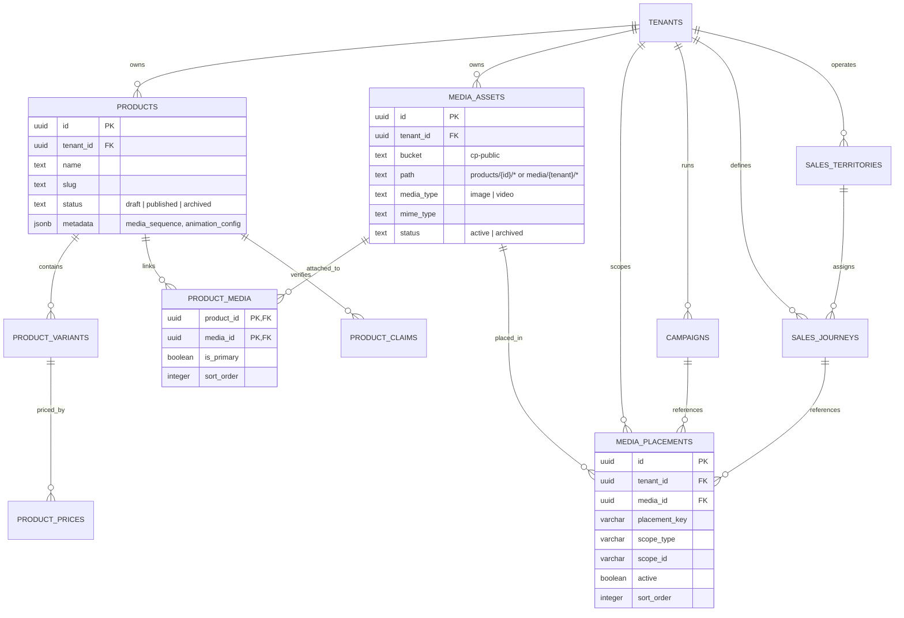
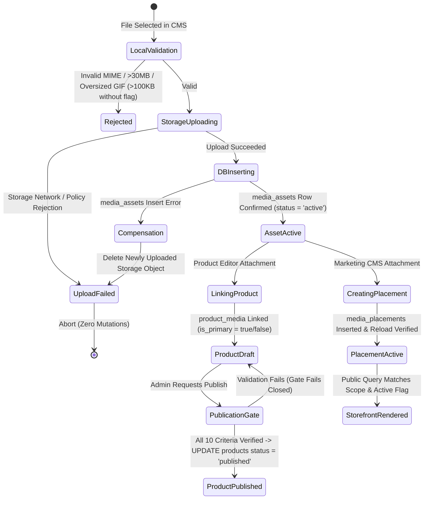

# CP SPLASH TARGET PUBLISHING SYSTEM SPECIFICATION
## End-to-End Schema, CMS Single Source of Truth (SSOT), and Product-to-Storefront Pipeline

**Document Status:** DRAFT / PROPOSED ARCHITECTURE SPECIFICATION  
**Target Repository:** `C:\Projects\cp-splash`  
**Supabase Production Project Ref:** `efvvczmopacoroudzfnl`  
**Specification Date:** 2026-10-15  
**Audit Standard:** HOEOS (Evidence Before Assumption, Verify Before Change, Root Cause Before Repair, Preserve Production)

---

## 1. Executive Summary & Status Classification

This document establishes the authoritative contract for CP Splash's CMS-to-Supabase-to-Storefront publishing pipeline.

> [!IMPORTANT]
> **Strict Fact Distinction:**
> - **Verified Production Reality (DEPLOYED):** The live PostgreSQL database contains exactly 10 recorded migrations (ledger ending `20261011011157`), multi-tenant ecommerce tables (`tenants`, `products`, `product_variants`, `product_prices`, `media_assets`, `product_media`), out-of-band sales tables (`sales_territories`, `sales_offers`, `sales_journeys`, `sales_leads`), and 4 product-specific storage policies on bucket `cp-public` scoped strictly to `products/{productId}/*`.
> - **Proposed System Specification (PENDING / NOT DEPLOYED):** The `media_placements` table, placement integrity triggers, placement RLS policies, and standalone `media/{tenant_id}/*` storage policies exist **only** as local migration drafts (`20261014000001` through `20261014000005`) and have **not** been applied to production.

---

## 2. Six Required Core Decisions

### 2.1 Area 1: Source of Truth (SSOT) Architecture
1. **Catalog Domain:** `public.products` is the sole source of truth for product identity, description, status, and animation configuration (`metadata.animation_config` and `metadata.media_sequence`). `public.product_variants` and `public.product_prices` represent inventory units and monetary prices.
2. **Media Asset Domain:** `public.media_assets` is the canonical registry for all uploaded files (bucket, path, MIME, media type, dimensions, status). Supabase Storage is an object store holding raw bytes; no Storage object is valid without a corresponding `media_assets` row.
3. **Association Domain:**
   - **Product Media:** `public.product_media` links products to media assets. Exactly one primary media link (`is_primary = true`) is required for a published product.
   - **General Placements (Proposed):** `public.media_placements` is the proposed join table decoupling media assets from marketing surfaces (`homepage_hero`, `product_menu`, `funnel_hero`, `funnel_card`, `campaign`, `sales_journey`).
4. **Publication Status:** A product is published **if and only if** `products.status = 'published'` in PostgreSQL. A placement is active **if and only if** `media_placements.active = true` and its underlying `media_assets.status = 'active'`.

### 2.2 Area 2: Tenant Isolation
1. **Multi-Tenancy Anchor:** Every table carries `tenant_id UUID NOT NULL REFERENCES public.tenants(id) ON DELETE CASCADE`.
2. **Authorization Gate:** Application write paths and table RLS policies evaluate `public.has_tenant_role(tenant_id, ARRAY['owner','admin','editor','manager'])`. Unauthenticated users have zero write permissions across the schema and Storage.
3. **Integrity Enforcement:** Cross-tenant assignments are rejected fail-closed at both database trigger level and application service level:
   - A `product_media` row cannot link a product of Tenant A to an asset of Tenant B.
   - A `media_placements` row cannot link Tenant A to a media asset, campaign, or sales journey belonging to Tenant B.

### 2.3 Area 3: Media Lifecycle & Transactional Compensation
1. **Validation & Classification:** Files are validated before upload against allowed MIME types (`image/jpeg`, `image/png`, `image/webp`, `image/gif`, `video/mp4`, `video/webm`) and max size (30 MB). GIFs retain `media_type = 'image'` with `mime_type = 'image/gif'`. Animations exceeding 100 KB require explicit administrator acknowledgement (`allowOversizedAnimation = true`).
2. **Safe Compensation:** Because Supabase Storage and PostgREST do not share a two-phase commit protocol:
   - If Storage upload fails, database insertion is aborted immediately.
   - If database insertion of `media_assets` fails after a successful Storage upload, the newly created Storage object is deleted via compensatory removal.
   - If deletion of an asset fails or its reference status is uncertain, the Storage object is **never** deleted.

### 2.4 Area 4: Placement Architecture
1. **Scope Decoupling:** Placements allow marketing surfaces to dynamically resolve media without hardcoded file paths or URLs:
   - `homepage_hero`: Banner media for the hero slider.
   - `product_menu`: Showcase imagery in navigation menus.
   - `funnel_hero` & `funnel_card`: Media for the five commercial funnels (`sports`, `parties-events`, `hotels-hospitality`, `schools`, `individuals`) keyed by `scope_id`.
   - `campaign` & `sales_journey`: Contextual banners bound to verified campaign/journey records.
2. **Resolution Query:** Storefront components execute targeted SELECT queries filtering on `tenant_id`, `scope_type`, `scope_id`, and `active = true`, joining `media_assets` where `status = 'active'`.

### 2.5 Area 5: Publication Contract
1. **Prerequisite Gate:** A product cannot transition to `status = 'published'` unless:
   - An active row exists in `public.products` matching current `tenant_id`.
   - An association exists in `public.product_media` with `is_primary = true`.
   - The primary media asset exists in `public.media_assets` with `status = 'active'`, `bucket = 'cp-public'`, `media_type = 'image'`, and approved MIME type.
   - The Storage path matches `products/{productId}/*`.
2. **Atomic Abort:** If validation fails, `updateProduct()` aborts prior to executing any mutation; product fields, variants, and prices remain completely unmodified.

### 2.6 Area 6: Migration Strategy & Reconciliation
1. **Preserve Production:** Production migrations `20261001093826` through `20261011011157` remain permanently intact.
2. **Reconciliation of Drafts:** Monolithic draft `20261014000000` is superseded by atomic single-responsibility migrations `20261014000001` through `20261014000005`.
3. **No Direct Production DDL:** Migrations must be dry-run in staging first. Production application requires explicit written authorization and a reversible rollback plan.

---

## 3. Entity Relationship Diagram (ERD)



---

## 4. Table-by-Table Schema Specification

### 4.1 `public.products` (DEPLOYED)
- **Primary Key:** `id` (`UUID DEFAULT gen_random_uuid()`)
- **Foreign Keys:**
  - `tenant_id` -> `public.tenants(id) ON DELETE CASCADE`
  - `category_id` -> `public.product_categories(id) ON DELETE SET NULL`
  - `created_by` -> `auth.users(id) ON DELETE SET NULL`
- **Constraints:**
  - `UNIQUE (tenant_id, slug)`
  - `CHECK (status IN ('draft', 'published', 'archived'))`
- **Indexes:** `idx_products_tenant_status ON public.products(tenant_id, status)`

### 4.2 `public.media_assets` (DEPLOYED)
- **Primary Key:** `id` (`UUID DEFAULT gen_random_uuid()`)
- **Foreign Keys:** `tenant_id` -> `public.tenants(id) ON DELETE CASCADE`
- **Constraints:**
  - `UNIQUE (tenant_id, bucket, path)`
  - `CHECK (media_type IN ('image', 'video', 'audio', 'document'))`
  - `CHECK (status IN ('pending', 'active', 'archived'))`
- **Indexes:** `idx_media_assets_tenant_bucket ON public.media_assets(tenant_id, bucket, status)`

### 4.3 `public.product_media` (DEPLOYED)
- **Primary Key:** `(product_id, media_id)`
- **Foreign Keys:**
  - `product_id` -> `public.products(id) ON DELETE CASCADE`
  - `media_id` -> `public.media_assets(id) ON DELETE CASCADE`
- **Integrity Trigger:** `trg_product_media_tenant_consistency` validates `media_assets.tenant_id == products.tenant_id`.

### 4.4 `public.media_placements` (PROPOSED — Split Migration 000001)
- **Primary Key:** `id` (`UUID PRIMARY KEY DEFAULT gen_random_uuid()`)
- **Foreign Keys:**
  - `tenant_id` -> `public.tenants(id) ON DELETE CASCADE`
  - `media_id` -> `public.media_assets(id) ON DELETE CASCADE`
- **Constraints:**
  - `CHECK (scope_type IN ('homepage_hero','homepage_carousel','product_menu','product_gallery','funnel_hero','funnel_card','campaign','sales_journey'))`
- **Indexes:**
  - `idx_media_placements_tenant_scope` on `(tenant_id, scope_type, scope_id, active, sort_order)`
  - `idx_media_placements_media_id` on `(media_id)`
  - `idx_media_placements_placement_key` on `(tenant_id, placement_key)`
- **Integrity Triggers (PROPOSED — Split Migrations 000002 & 000003):**
  - `trigger_media_placements_modtime`: Updates `updated_at = NOW()`.
  - `trigger_media_placement_tenant_consistency`: Rejects if `media_assets.tenant_id != media_placements.tenant_id`, or if `scope_type = 'campaign'` / `'sales_journey'` references an entity belonging to another tenant.

---

## 5. Tenant Authorization & Access Control Matrix

| Table / Object | Role / Identity | Operation | Predicate / Policy Definition | State |
| :--- | :--- | :--- | :--- | :--- |
| `products` | Anonymous Public | SELECT | `status = 'published'` | DEPLOYED |
| `products` | Authenticated Staff | ALL | `has_tenant_role(tenant_id, ARRAY['owner','admin','editor','manager'])` | DEPLOYED |
| `media_assets` | Anonymous Public | SELECT | `status = 'active'` | DEPLOYED |
| `media_assets` | Authenticated Staff | ALL | `has_tenant_role(tenant_id, ARRAY['owner','admin','editor','manager'])` | DEPLOYED |
| `product_media` | Anonymous Public | SELECT | `EXISTS (SELECT 1 FROM products p WHERE p.id = product_id AND p.status = 'published')` | DEPLOYED |
| `product_media` | Authenticated Staff | ALL | `EXISTS (SELECT 1 FROM products p WHERE p.id = product_id AND has_tenant_role(p.tenant_id, ...))` | DEPLOYED |
| `media_placements` | Anonymous Public | SELECT | `active = true AND EXISTS (SELECT 1 FROM media_assets ma WHERE ma.id = media_id AND ma.status = 'active' AND ma.bucket = 'cp-public')` | PROPOSED |
| `media_placements` | Authenticated Staff | ALL | `has_tenant_role(tenant_id, ARRAY['owner','admin','editor','manager'])` | PROPOSED |
| Storage (`products/*`) | Authenticated Staff | ALL | `bucket_id = 'cp-public'` AND depth 2 AND `(foldername)[1] = 'products'` AND `has_tenant_role(product.tenant_id, ...)` | DEPLOYED |
| Storage (`media/*`) | Authenticated Staff | INSERT, DELETE | `bucket_id = 'cp-public'` AND depth 2 AND `(foldername)[1] = 'media'` AND `has_tenant_role((foldername)[2]::uuid, ...)` | PROPOSED |
| Storage (Public Reads) | Anonymous Public | GET | Served via `/storage/v1/object/public/cp-public/*` (`bucket.public = true`) | DEPLOYED |

---

## 6. Media Upload, Placement, and Publication State Machine



---

## 7. Storage Path Contracts and Access Rules

### 7.1 Path Contracts
1. **Product Media Path (PRESERVED):**
   - Format: `products/{productId}/{timestamp}_{nonce}_{cleanFileName}`
   - Folder Depth: Exactly 2 (`array_length(storage.foldername(name), 1) = 2`)
   - Prefix Segment 1: `'products'`
   - Prefix Segment 2: Must match an existing `public.products.id` UUID.
2. **General CMS Media Path (PROPOSED):**
   - Format: `media/{tenant_id}/{timestamp}_{nonce}_{cleanFileName}`
   - Folder Depth: Exactly 2 (`array_length(storage.foldername(name), 1) = 2`)
   - Prefix Segment 1: `'media'`
   - Prefix Segment 2: Must match a valid UUID representing a `public.tenants.id`.
3. **Forbidden Direct Storage Prefixes:**
   - `homepage/`, `menu/`, `funnels/`, `campaigns/`, `journeys/` are **prohibited** as root Storage folders. All CMS media is physically placed in `media/{tenant_id}/*` and logically referenced by `media_placements`.

---

## 8. Failure-Handling and Compensation Specification

| Failure Point | System Action | Compensation Executed | Post-Condition |
| :--- | :--- | :--- | :--- |
| **Storage Upload Fails** | Intercept upload error | No database writes issued | Zero database artifacts; clean client error returned |
| **Asset Metadata Insert Fails** | Intercept database insert error | Execute `storage.from('cp-public').remove([storagePath])` | Storage object purged; zero orphaned files |
| **Product Link (`product_media`) Fails** | Intercept link insert error | Check asset reference count; if 0, delete `media_assets` row and Storage object | Clean state; no orphan asset records |
| **Primary Clear Fails** | Intercept update error | Compensate new asset and Storage object | Prior primary retained; product unaffected |
| **Product Publication Gate Fails** | Intercept validation error | Abort `updateProduct()` prior to issuing UPDATE | Zero fields updated; product remains unpublished |
| **Placement Reload Verification Fails** | Database query fails to reload inserted placement | Return explicit error state; do not report success | UI displays failure; zero mock success states |

---

## 9. Migration Dependency and Rollback Plan

### 9.1 Migration Order (Forward Dependency)
1. `20261014000001_media_placements_table.sql`: Creates `media_placements` table, indexes, and FKs to `tenants` and `media_assets`.
2. `20261014000002_media_placements_modtime.sql`: Installs `update_media_placements_modtime()` trigger.
3. `20261014000003_media_placements_integrity.sql`: Installs `check_media_placement_tenant_consistency()` trigger.
4. `20261014000004_media_placements_rls.sql`: Enables RLS and grants public SELECT & tenant admin ALL.
5. `20261014000005_cp_public_storage_scope.sql`: Installs `cp_public_media_insert` and `cp_public_media_delete` on `storage.objects`.

### 9.2 Rollback Plan (Inverse Order)
```sql
-- Rollback 000005
DROP POLICY IF EXISTS cp_public_media_delete ON storage.objects;
DROP POLICY IF EXISTS cp_public_media_insert ON storage.objects;

-- Rollback 000004
DROP POLICY IF EXISTS "Tenant admin manage media placements" ON public.media_placements;
DROP POLICY IF EXISTS "Public read access for active media placements" ON public.media_placements;

-- Rollback 000003
DROP TRIGGER IF EXISTS trigger_media_placement_tenant_consistency ON public.media_placements;
DROP FUNCTION IF EXISTS public.check_media_placement_tenant_consistency();

-- Rollback 000002
DROP TRIGGER IF EXISTS trigger_media_placements_modtime ON public.media_placements;
DROP FUNCTION IF EXISTS public.update_media_placements_modtime();

-- Rollback 000001
DROP TABLE IF EXISTS public.media_placements CASCADE;
```

---

## 10. Traceable Test Matrix

| Test Suite / Path | Target Verifications | Pass Criterion |
| :--- | :--- | :--- |
| `tests/media_service_contract.test.ts` | 6 MIME formats (JPEG, PNG, WebP, GIF, MP4, WebM), size limits, metadata inference, tenant authorization check | 32/32 Passed |
| `tests/product_publication_gate.test.ts` | 10 publication prerequisites, atomic abort on `updateProduct()`, rejection of unlinked/draft/archived/foreign media | 24/24 Passed |
| `tests/media_pipeline_placements.test.ts` | `media/{tenant_id}/*` storage path enforcement, cross-tenant denial, reload verification, placement deletion without asset destruction | 31/31 Passed |
| `tests/probe_media_animation.cjs` | 6-part animation sequence, animation configuration persistence, storefront query | PASSED |
| `tests/e2e_cms_storage_storefront.cjs` | End-to-end admin product creation, price creation, media upload, public storefront fetch | 100% Deterministic Pass |
| `tests/e2e_five_funnels_certification.cjs` | Commercial sales funnels (`sports`, `parties-events`, `hotels-hospitality`, `schools`, `individuals`) | Pass in Staging release |

---

## 11. Acceptance & Sign-off Gate

This target specification fulfills all Phase 2 requirements:
- [x] Entity relationship diagram provided.
- [x] Table-by-table schema specification detailed.
- [x] Tenant/role/operation authorization matrix established.
- [x] Media upload, placement, and publication state machine diagrammed.
- [x] Storage path contracts and access rules documented.
- [x] Failure-handling and transactional compensation specified.
- [x] Migration dependency and rollback plan defined.
- [x] Traceable test matrix covering all surfaces specified.
